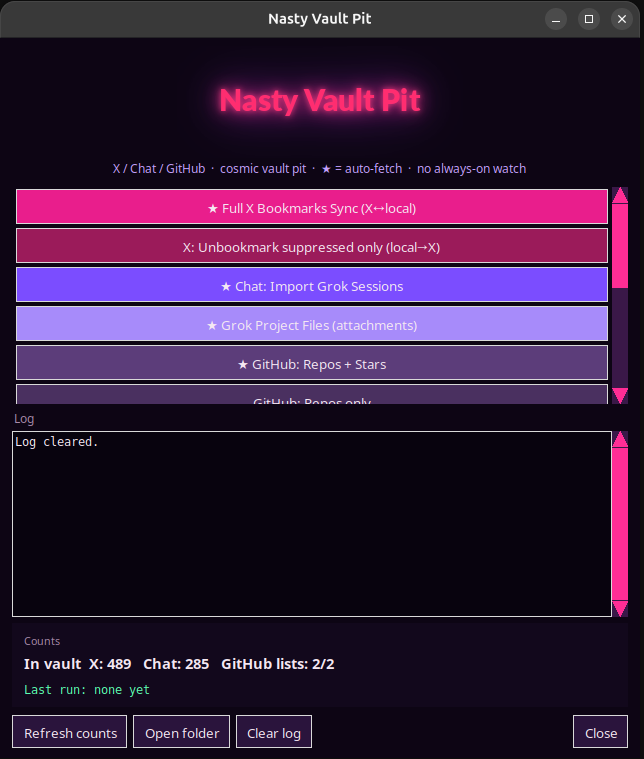

# Nasty Ingest Pit

Formerly the vault hub. Same one-click sync — **cosmic purple / hot magenta** night-ops skin.

On-demand launcher for a local Obsidian vault: X bookmarks, Grok session notes, and GitHub lists. Press a button, it runs, it stops. No always-on watcher.


## Screenshots



---

## Features

Buttons in the pit:

- **Full X Bookmarks Sync (X↔local)** — pull bookmarks into the vault, and push local deletes back to X
- **Unbookmark suppressed only (local→X)** — remove on X what you already dropped locally
- **Chat: Import Grok Sessions** — session notes into the vault
- **Grok Project Files (attachments)** — local copies of project files into project folders
- **GitHub: Repos + Stars** — both lists
- **GitHub: Repos only** / **GitHub: Stars only**
- **All (X + Chat + Files + GitHub)** — one pass of the four
- **X _drop** / **Chat _drop** / **Both _drop** — ingest files you dropped in by hand
- **Canvas: All Lilith Sessions Overview** — a folder map, no model call

The log and the vault counts stay on screen. The title glows. The scrollbars stay hot pink without a hover.

---

## Requirements

| Item | Notes |
|------|--------|
| OS | Linux |
| Python | 3 |
| X sync | Firefox logged into x.com, and `bird` on `PATH` (cookies are read at run time, not stored here) |
| GitHub sync | `gh` authenticated (`gh auth status`) |
| Optional | Obsidian Local REST API. If it is down, notes are written to the filesystem |
| Optional | Pillow, for the glowing title. Without it the title is a plain label |

---

## Quick start

```bash
git clone git@github.com:TX-220/nasty-ingest-pit.git
cd nasty-ingest-pit

export OBSIDIAN_VAULT=/path/to/your/vault
python3 hub_launcher.py
```

If this folder lives at `<vault>/Scripts`, `OBSIDIAN_VAULT` can be omitted. The default vault is the parent directory.

A terminal menu is also there: `./hub_launcher.sh`.

---

## Local config

These stay on your machine. They are not in git.

- `config/grok_project_files.json` — copy from `config/grok_project_files.example.json` and set your own paths.
- `hub_launcher.desktop.example` — desktop entry. Replace `/PATH/TO/nasty-ingest-pit` before installing it.

---

## Chat: highlights + full session mirror

A normal run now writes the highlight notes (as before) **and** mirrors every raw Grok session:

```bash
python3 chat_sync_sessions.py                    # highlights + full mirror (default)
python3 chat_sync_sessions.py --highlights-only  # old behavior, highlights only
python3 chat_sync_sessions.py --full-mirror      # mirror only (add --dry-run to preview)
python3 chat_sync_sessions.py --mirror-delete    # also prune files the mirror wrote earlier
```

Every file under `~/.grok/sessions` is copied. Each session directory goes to **`Second-Brain/Lilith/Projects/<project>/<session-id>/`**.
`<project>` is the hub genre in `~/.grok/vesper-hub.json` (Infra & Environment, Security, Freelance, Trade Bot, Information Dominance, Game Dev, Uncategorized). It is not the keyword bucket in `chat_projects.json`.
Files that are not inside a session (`prompt_history.jsonl`, `sandbox-events.jsonl`, `session_search.sqlite`) stay in `Lilith/Sessions/`.
The run ends with `MIRROR dest=<absolute path> source=<sessions dir> sessions=N files=N copied=N unchanged=N`, and warns if the sessions dir is missing or empty.
Unchanged files are skipped by source size and mtime, symlinks are not followed, nothing is written outside `Lilith/`, and nothing is deleted without
`--mirror-delete` (manifest-tracked files only). A previous flat copy at `Lilith/Sessions/<session-id>/` is removed after the files land under `Projects/<project>/<session-id>/`. Run with `python3` (the script is not marked executable).

The same default run also pulls Lilith's grok.com project chats (one Markdown file per conversation). It uses whichever Firefox profile is already logged into grok.com. No login is a clean skip (`added=0`), not a failed sync. A later run downloads a conversation only when its `modifyTime` changed or the note is missing.

GitHub sync still asks `gh` for the current list, then rewrites `Repositories.md` / `Stars.md` only when that list changed. `added=` is how many notes were written, not how many repositories came back.
Grok project files: the Files button pulls each grok.com project's file library into `Second-Brain/Lilith/Projects/<project>/Files/`. A later run downloads a file only when its size or modified time changed. Local paths already inside the vault are not copied again, and keyword bucket names (`Grok-Full-Fusion`, `Web-Dev`, and the rest) are not created as project folders.

**Full copy first.** Every file in each session directory is mirrored, including binary, non-UTF-8 and sensitive-named files (`.env`, `*.pem`, ...).
As defense in depth, UTF-8 text gets a light redaction pass (rules version `2026-10-31.2`, see `redact_lib.py`): obvious API keys/tokens
(AWS, GitHub, OpenAI, Anthropic, xAI, Slack, Google, Stripe, Hugging Face, GitLab, npm, Telegram/Discord bot), JWTs, PEM private keys,
`Bearer` tokens, URL credentials and exact secret key names (`password`, `api_key`, `token`, `secret`, `cookie`, ...) become `[REDACTED:<type>]`.
Normal fields like `author` or `num_tokens` are left alone. Binary/non-UTF-8 files are copied byte for byte; if redaction fails on a file it is copied raw
and counted in the summary (`redaction_errors_copied_raw=`). Writes are atomic and keep mtimes. Output shows paths and counts only, never values;
`--redaction-report` adds per-file counts.

> **The vault is local and private.** Mirrored sessions can still contain secrets that the regex pass misses (and raw copies of binary files).
> Never publish, share, or push the vault, or `Lilith/Projects/*/Sessions/`, to any public place.

---

## License

MIT — see [LICENSE](./LICENSE).

Copyright (c) 2026 TX-220 with assistance from [Grok (xAI)](https://x.ai).
